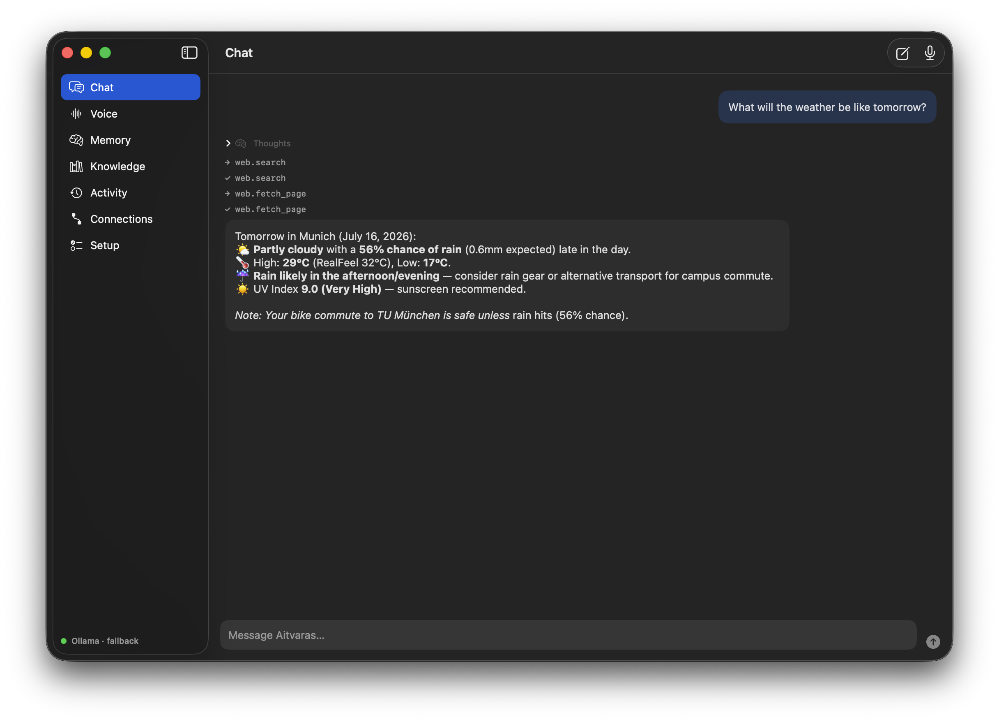
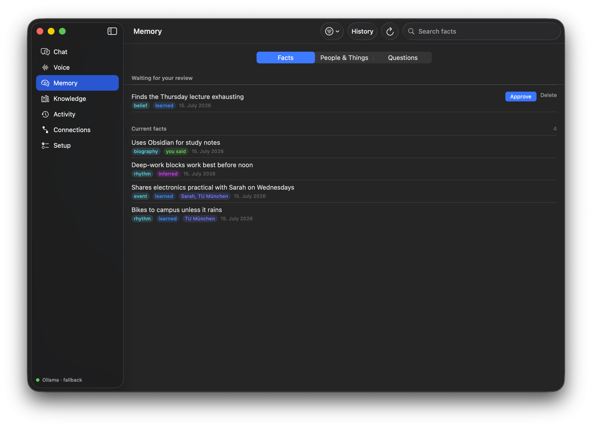
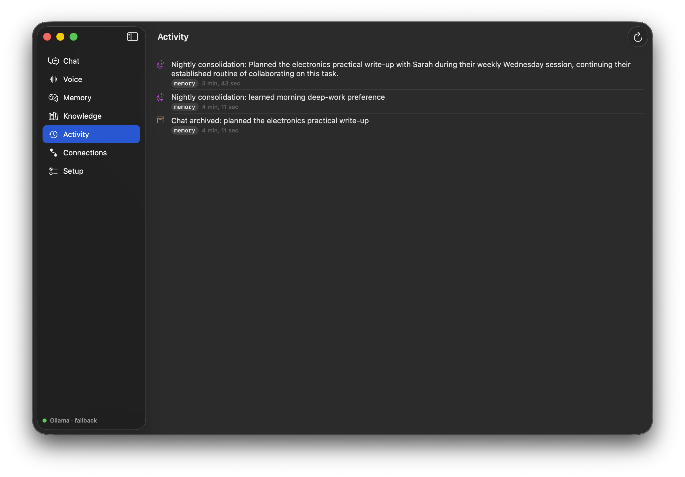
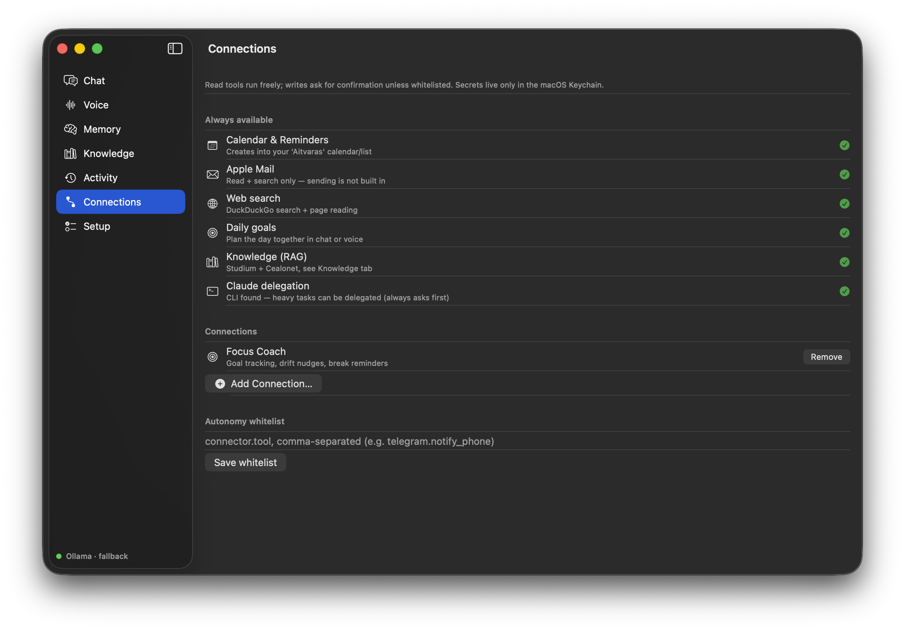
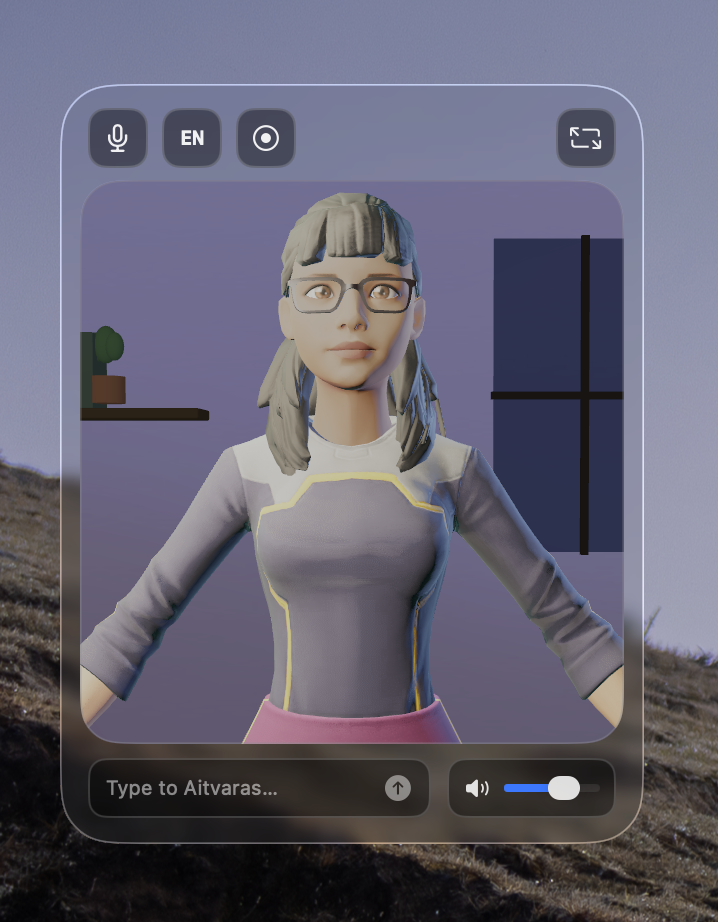
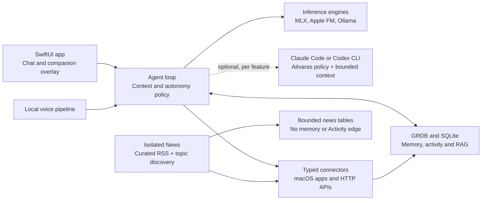

# Aitvaras

A local-first agentic AI assistant for macOS, with an animated 3D companion
character, high-quality bilingual (DE/EN) voice, structured long-term memory,
and deep integration into native macOS apps and personal infrastructure.

**Local inference is the default** (Apple Silicon, MLX), state stays on the
Mac, and no cloud API key is required. Four features can optionally use an
already authenticated Claude Code or Codex CLI subscription; each is
configured independently and shows exactly which bounded information leaves
the Mac before it is enabled. Mail stays in Mail.app, notes stay on disk,
facts stay in a local SQLite file, and prompts/responses are not copied into
the local cloud-usage ledger.

[Portfolio](https://leonardmo.com) · [Architecture](docs/ARCHITECTURE.md) ·
[Roadmap](docs/ROADMAP.md)

Lecture capture includes live captions, optional local source-audio retention,
and user-started Qwen/Whisper re-transcription with separate saved versions.
See the [capture workflow and privacy controls](docs/CAPTURE-REFINEMENT.md).

## Why I built this

I built Aitvaras after finding OpenClaw too operationally heavy for what I
wanted from a personal assistant. Instead of running a general-purpose gateway
and server stack, I wanted a focused local application that makes the computer
I already use smarter during everyday work.

The companion avatar is a deliberate part of that idea rather than decoration:
an always-available overlay makes interaction immediate, visible and more fun
than opening another chat tab.

> **Fun fact — why "Aitvaras"?** The name comes from the **aitvaras** of
> Lithuanian folklore: a small household dragon (often pictured as a fiery
> rooster-tailed serpent) that nests behind the hearth — the warmest spot in
> the house — and brings its keeper grain, milk and gold, provisioning the
> household from the world outside. A local AI that lives on the warm little
> server in the corner and carries data home is, functionally, the same
> creature. The name was also chosen for wake-word engineering reasons: 3–4
> syllables with a strong alveolar plosive /t/ and a distinct /ai/ diphthong
> make an acoustically robust, rarely-false-triggered activation word, and it
> does not collide with a common human name. The full
> naming research (phonetics, wake-word design, mythology — in German) lives
> in [docs/AITVARAS.md](docs/AITVARAS.md).

## What Aitvaras does

- **Companion character** — a stylized 3D figure in a floating always-on-top
  window (global hotkey ⌥Space), plus a full desktop app for chat, memory,
  activity and settings.
- **Voice** — hands-free conversation with barge-in; on-device STT
  (SpeechAnalyzer) and neural TTS (Chatterbox multilingual / Kokoro) in German
  and English, with instant Apple-voice fallback.
- **Memory that learns** — not a chat log: typed, entity-tagged facts with
  validity history (corrections supersede, never silently overwrite). Ending
  conversations are flushed into episode summaries + durable facts; a nightly
  consolidation pass reconciles the day against what's known, infers patterns,
  and writes a digest you can audit. Its default 04:00 boundary does not wake a
  sleeping Mac: the update catches up once after the next launch or wake,
  following a short settling delay and battery check. Schedule, time, delay
  and power policy are configurable, with Run now and visible last/next/reason
  status. Sensitive inferred facts are quarantined
  until you approve them. Everything is browsable and editable in the
  **Memory** view — including the questions Aitvaras would like to ask you.
- **Wake briefings** — after the Mac has slept for at least five minutes,
  Aitvaras catches up Mail, enabled system notifications and configured Moodle,
  then greets you with one short recap of what arrived while you were away.
  The spoken recap is assembled from local activity counts only: message
  subjects, bodies and links are never repeated or sent through a summarizing
  model. Individual catch-up alerts are suppressed to avoid a notification
  burst, while the normal sender-review and confirmation boundaries remain in
  force. Each source is bounded to its 200 most relevant replay items; if that
  ceiling is reached, the recap says its count is partial.
- **Learned command shortcuts** — after the same exact low-risk command has
  completed through the same fixed tool path three times, Aitvaras compiles an
  inspectable shortcut. The next matching spoken or typed command runs that
  path directly without an AI model; the companion visibly says that the fast
  path was taken. A dedicated **Shortcuts** view shows trigger → ordered tools
  → arguments → result and lets you edit, pause or delete it. Similar-time
  patterns can become schedule suggestions, but they remain inert until you
  explicitly review and activate them. Confirmation-required actions are
  never eligible for either path.
- **Quiet, source-first News** — configure topics with their own importance
  and refresh interval, then read or listen on demand in a separate visual
  feed. The editable starter set covers practical AI tools and workflows,
  international politics and Germany; add or remove topics directly in the
  reader. Curated direct feeds (including SPIEGEL, Tagesschau, BBC, DW, Nature
  and primary AI labs) are combined with topic discovery that admits only an
  explicit quality allow-list; cross-source coverage receives a ranking boost.
  Aitvaras may offer one briefing at a chosen morning time, but individual
  stories never interrupt. Images, publisher summaries and original links stay
  in a dedicated reader and never become Activity events or long-term memory.
  SPIEGEL+ links open in the normal signed-in browser without importing its
  cookies. X/Twitter is excluded until it can meet the same provenance bar.
- **Phishing-aware mail triage** — reads new mail across accounts (leaves it
  unread), holds unknown senders before model access, and lets you approve
  exact contacts in a local review screen. Approved mail is classified in a
  quarantine with no Memory, Knowledge, web or mail tools; event/reminder
  proposals still require one-tap confirmation. Shared domains such as
  `t-online.de` cannot be approved wholesale. **Aitvaras cannot send email,
  by design.**
- **Calendar & Reminders** — creates events and todos via EventKit; only ever
  modifies items she created herself.
- **Knowledge (RAG)** — add any folders (notes vault, code repos); hybrid
  semantic + keyword search grounds answers in your actual material.
- **Moodle** — assignment deadlines and course events via the iCal export
  (built against a university Moodle, works with any instance that has calendar
  export enabled).
- **Homelab** — read-only status of Proxmox and TrueNAS plus verified,
  searchable Home Assistant entity state and narrowly scoped idempotent light
  on/off control via HTTP APIs (no SSH). Home Assistant connection details are
  installation-local: its token is Keychain-only and its URL stays in local app
  state. Arbitrary HTTP APIs can be added from a JSON manifest without writing
  Swift.
- **Optional cloud-agent quality** — Claude Code and Codex CLI are equal,
  subscription-backed choices for confirmed workspace delegation, nightly
  memory consolidation, connector-manifest creation and presentation-only
  review of learned shortcuts/automation proposals. Every call receives the
  same versioned, Aitvaras-owned safety instructions. Nightly memory and
  routine review default to local-only; routine execution is always local and
  deterministic.
- **Autonomy with an audit trail** — every side effect passes a risk policy
  (read / reversible / needs-confirmation) and lands in the activity log with
  its full provenance chain ("event created ← suggestion accepted ← mail
  classified urgent ← mail received").

## Interface

The native app keeps chat, reviewable memory, activity provenance and
connections visible in one place.

| Chat | Memory |
| --- | --- |
| [](docs/images/aitvaras-chat.png) | [](docs/images/aitvaras-memory.png) |
| **Activity** | **Connections** |
| [](docs/images/aitvaras-activity.png) | [](docs/images/aitvaras-connections.png) |

### Floating companion

<p align="center">
  <a href="docs/images/aitvaras-companion.png">
    
  </a>
</p>

The long-term character direction is an original small dragon inspired by the
aitvaras of Lithuanian folklore. I am still developing that model; the current
dragon prototype did not yet meet the visual quality bar for the public
version. For now, the companion therefore falls back to
[`avatars/brunette.glb`](https://github.com/met4citizen/TalkingHead/blob/main/avatars/brunette.glb)
from Mika Suominen's MIT-licensed
[TalkingHead](https://github.com/met4citizen/TalkingHead) project. It is a
Ready Player Me-generated character with facial blendshapes that support
blinking, expressions and voice-driven lip sync. The source and third-party
license notice are preserved in
[`App/Resources/AVATAR-CREDITS.md`](App/Resources/AVATAR-CREDITS.md).

## Technical highlights

- **Native macOS architecture** — Swift 6 with strict concurrency, SwiftUI and
  AppKit for the application shell, and SceneKit for the animated companion.
- **Original animated dragon mesh** — a reproducible 24k-triangle GLB with 74
  named parts for the skull, scales, armour, limbs, wings, jaw, eyes, curled
  tail and flame; SceneKit drives expression and voice response without a
  skeletal rig.
- **Modular core** — separate SwiftPM modules for domain logic, inference,
  voice, storage, retrieval, connectors and the agent loop. Most functionality
  builds and tests independently of Xcode.
- **Local multi-model inference** — MLX runs tiered Qwen models in-process;
  Apple Foundation Models handles suitable lightweight tasks, with an optional
  localhost Ollama adapter behind the same inference protocol.
- **Full-duplex voice pipeline** — on-device Apple speech recognition,
  interruption and barge-in handling, neural speech synthesis through a local
  sidecar, plus an immediate system-voice fallback.
- **Inspectable long-term memory** — GRDB-backed SQLite storage with temporal
  facts, provenance, corrections, review queues, FTS5 keyword retrieval and
  optional vector search.
- **Typed integration boundary** — every connector exposes schema-defined
  tools with an explicit risk level. A central autonomy policy gates side
  effects before they reach Calendar, Reminders, Mail or external APIs.
- **Deterministic routine compiler** — successful fixed command paths are
  normalized, canonicalized and counted in bounded local SQLite history. Exact
  phrase shortcuts compile after three consistent runs; circular time
  clustering proposes daily, weekday or weekly schedules. Runtime execution
  revalidates every tool and risk label, bypasses inference, records full
  provenance and claims scheduled slots before side effects to prevent replay.
  An optional cloud review can improve only a candidate's visible title and
  explanation; it cannot alter its trigger, tools, arguments, risk, approval
  state or execution.
- **Bounded cloud-agent gateway** — one provider-neutral service applies
  Aitvaras's static policy, sanitized CLI environments, structured-output
  validation and Claude→Codex fallback consistently. Provider choice is
  granular per feature and changes take effect on the next call without a
  restart. A local metadata-only ledger records per-feature history, provider,
  duration, data categories and provider-reported token/cost data when
  available; a monthly call limit can stop further calls.
- **On-device inference metering** — MLX and Ollama report exact input/output
  token counts; engines without usage APIs are explicitly estimated. The
  Models screen breaks local token credits down by model and role. These
  credits have no monetary cost, and prompt/response content is never stored
  in the usage tables.
- **External-message quarantine** — unknown mail/notification senders are held
  before inference; approved senders still receive no private context or read
  tools, and can only produce confirmation-gated event/reminder proposals.
- **Crash-safe wake lifecycle** — macOS sleep/wake notifications create a
  durable SQLite boundary, replayable connectors use stable IDs for catch-up,
  and briefing audit + boundary consumption commit atomically. Duplicate wake
  signals cannot repeat a recap, and an older catch-up cannot erase a newer
  sleep period.
- **News provenance boundary** — RSS/Atom parsing, a publisher allow-list,
  source-quality and freshness scoring, duplicate-story clustering and bounded
  per-topic caches are deterministic Swift code. Publisher text is marked
  untrusted, topic configuration is UI-only, and news tables have no path into
  conversations, RAG, Activity or the consolidator.
- **Testable isolation** — deterministic model fakes and relocatable state
  profiles exercise memory, retrieval, connectors and migrations without
  touching real user data.

## Architecture at a glance



## Requirements

- Apple Silicon Mac, 32 GB+ RAM recommended for the default model set
- macOS 26+, Xcode 26+, [XcodeGen](https://github.com/yonaskolb/XcodeGen)
- Models in `~/Library/Application Support/Aitvaras/Models/` — Qwen3-30B-A3B-4bit
  and Qwen3-4B-4bit (MLX format; downloadable from Setup → Models)
- Optional: [Ollama](https://ollama.com) with `nomic-embed-text` for
  embeddings (keyword search works without it; embeddings backfill later)
- Optional: Python 3.11+ for the neural-voice sidecar (installed from Setup)

## Build & run

```sh
brew install xcodegen                 # once
./scripts/build-release.sh            # builds + installs /Applications/Aitvaras.app
```

Development:

```sh
swift test                            # core logic, no Xcode needed
xcodegen generate && open Aitvaras.xcodeproj    # scheme "Aitvaras"
```

First launch: work through **Setup** in the sidebar (permissions, models,
voice, connections). Nothing is preconfigured — integrations exist only after
you add them.

## Testing

See [docs/TESTING.md](docs/TESTING.md). Highlights: deterministic fakes for
model plumbing, an end-to-end-tested migration chain, and **isolated
profiles** — `AITVARAS_STATE_DIR=/tmp/x Aitvaras --seed-demo-state` boots the app
against a throwaway state tree seeded with a fictional persona, so live
testing (by you or an agent) never touches real memories.

```sh
./scripts/test-smoke.sh               # tests + app build + privacy sweep
```

## Documentation

- [docs/DECISIONS.md](docs/DECISIONS.md) — every product/architecture decision, numbered, with rationale
- [docs/ARCHITECTURE.md](docs/ARCHITECTURE.md) — module layout and data flow
- [docs/ROADMAP.md](docs/ROADMAP.md) — milestone status
- [docs/MESSAGE-TRUST.md](docs/MESSAGE-TRUST.md) — trusted senders, phishing limits and prompt-injection boundary
- [docs/AITVARAS_CLOUD_AGENT.md](docs/AITVARAS_CLOUD_AGENT.md) — static cloud-agent policy and local usage accounting
- [docs/MASTERPLAN.md](docs/MASTERPLAN.md) — the forward plan: situational awareness + the learning loop
- [docs/research/](docs/research/) — the evidence base (agent-memory survey, multi-model patterns, OpenClaw teardown)

## Privacy model

Local-first is the point, not a feature flag: inference on-device, state in
one SQLite file you own, secrets only in the macOS Keychain, mail read-only
by hard rule, and an activity log that can explain every action. The memory
system additionally quarantines sensitive inferred facts until approved and
keeps superseded facts as inspectable history instead of silently rewriting.
External mail and notification identities have a separate local review queue:
unknown senders never reach a model, while approved senders remain unverified
data inside a context- and tool-isolated execution profile.
News is an explicit network feature: configured topic terms are sent to Google
News for discovery and fixed publisher feeds are downloaded directly. The
resulting cache stays in the local SQLite profile; browser credentials and
SPIEGEL+ cookies never enter Aitvaras.
Cloud CLI use is also explicit and independently selectable for delegation,
nightly memory, connector creation and shortcut/automation review. Changes
apply to the next call immediately. The Models screen explains the exact data
categories and tool access for each feature. Aitvaras prepends
its own versioned policy, disables personal CLI configuration, and uses an
empty temporary workspace for non-delegation calls. Credentials are never
included. Learned routines are created and executed locally; optional cloud
review can change only their human-facing title and explanation. Cloud history
is shown per feature, and on-device token credits are shown per model/role.
Both local ledgers contain metadata, not prompt or response content.

## Credits

- [MLX](https://github.com/ml-explore/mlx-swift) + [mlx-swift-lm](https://github.com/ml-explore/mlx-swift-lm) — on-device inference
- [Qwen3](https://github.com/QwenLM/Qwen3) — chat/voice/background models
- [GRDB](https://github.com/groue/GRDB.swift) — SQLite persistence
- [GLTFKit2](https://github.com/warrenm/GLTFKit2) — avatar loading
- Optional human avatar from the [TalkingHead](https://github.com/met4citizen/TalkingHead) project (MIT)
- [Chatterbox](https://github.com/resemble-ai/chatterbox) & [Kokoro](https://huggingface.co/hexgrad/Kokoro-82M) (via [mlx-audio](https://github.com/Blaizzy/mlx-audio)) — neural TTS

## License

This repository is source-available for portfolio and review purposes. No
license is granted; all rights are reserved.
